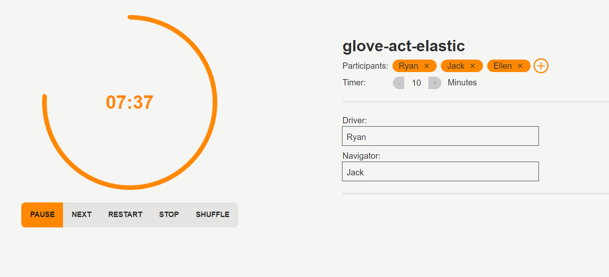

# pairprogram.me

A SvelteKit powered app to aid pair programming in a team environment. Previously available at [pairprogram.me](https://pairprogram.me/)

Set a custom time and add your team members and share your persistant room to get started! More than 2 people or just prefer mobbing? There is no cap on participants, a driver and navigator will still automatically cycle through.



# Setup
A [Firebase RTDB](https://firebase.google.com/) setup is needed

# Production Setup
This app can be built via Docker which can be hosted locally or via a cloud provider:
```bash
docker build -t pairprogramme .
docker run -p 3000:3000 pairprogramme
```
